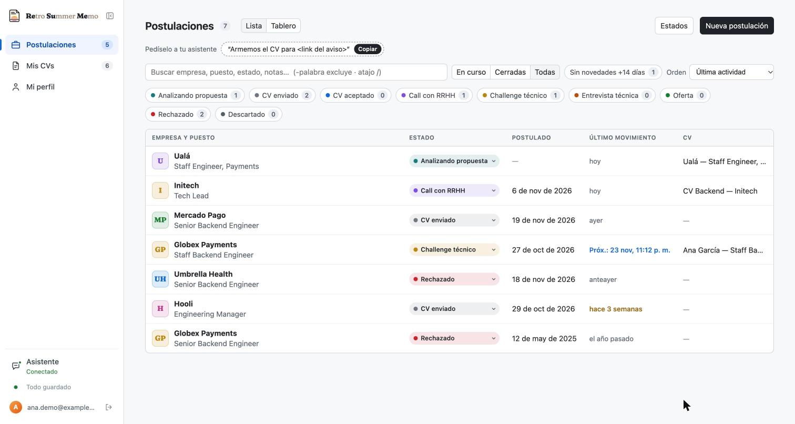
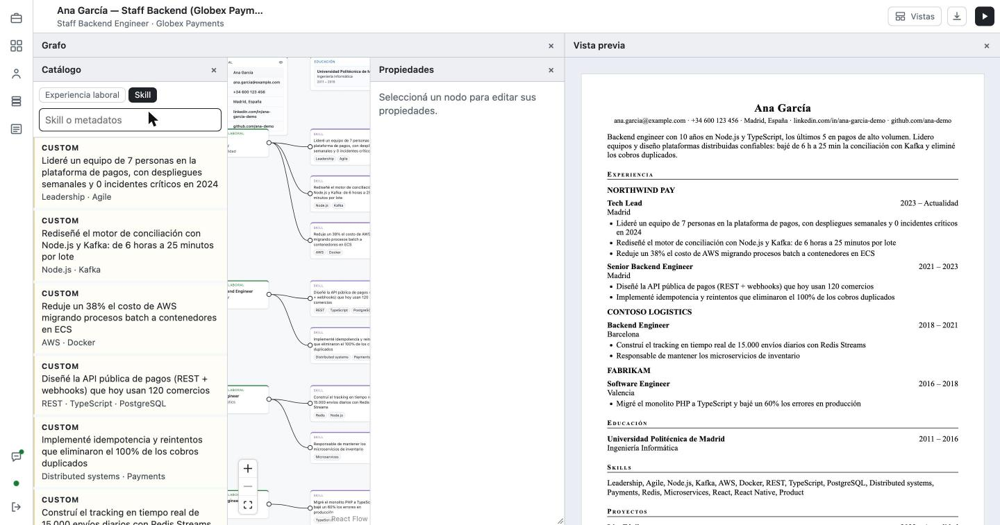

# CV builder + job applications tracker

Build tailored CVs from a graph of your experience, and track every application you send:
which CV (exact version) went where, what step each process is in, and whether you already
applied to that posting or role before.

It is driven by your assistant (ChatGPT, Claude, Gemini…) through an MCP server: "Actualizá mi info
en Resume", "Armemos el CV para <link>", "Me confirmaron de Acme, paso al challenge el 20/3". The app
is the engine and the viewer, and shows the assistant's changes live.

| Applications | A CV built for a posting |
| --- | --- |
|  |  |

More in [docs/screenshots](docs/screenshots).

## Architecture

```
src/
  domain/     pure model and rules: CV graph, build, matching, applications, parsing
  app/        use cases on top of the ports (e.g. openDocument)
  ports/      interfaces the app depends on: DocumentStore, AuthGateway
  adapters/   implementations: local (localStorage), supabase (Postgres + Auth + Realtime)
  backend.ts  composition root: picks the adapters from the environment
  ui/         React: Root (sign-in, loading), App, components
supabase/     local stack config and SQL migrations (RLS: each user sees only their rows)
```

The UI and the use cases only talk to `ports/`. Swapping the backend means writing another
adapter that passes `ports/documentStore.contract.ts`.

## Run it

```bash
npm install
npm run db:start                      # local Supabase in Docker (first run downloads images)
cp .env.example .env.local            # then paste the publishable key from:
npx supabase status -o env            #   PUBLISHABLE_KEY=...
npm run dev                           # http://localhost:5173
```

Sign in with any email; locally the link arrives in Mailpit at http://127.0.0.1:54324.
On first sign-in, data saved in this browser by the older localStorage version is imported.

Without `VITE_SUPABASE_*` the app runs entirely in the browser, as before.

## Cloud project

`npm run dev` talks to the local stack (`.env.local`); `npm run build` / `npm run preview` use
`.env.production.local` (cloud URL + publishable key, gitignored). The secret key is never needed
by the app: Edge Functions (the MCP) receive it from Supabase itself.

```bash
npx supabase login                                   # once, opens the browser
npx supabase link --project-ref attrxmtjyjzfgopfrgnk
npx supabase db push --remote                        # applies supabase/migrations (without
                                                     # --remote, CLI 3.x targets the local stack)
```

Redirect URLs (Authentication → URL Configuration) must include every origin the app is served
from, or sign-in links bounce to the Site URL. Set: Site URL `https://retro-summer-memo.vercel.app`,
redirects `https://retro-summer-memo.vercel.app` and `http://localhost:4173` (preview).

## Deploy

The frontend is a static build on Vercel (Supabase does not host frontends):
https://retro-summer-memo.vercel.app. `VITE_SUPABASE_URL` / `VITE_SUPABASE_PUBLISHABLE_KEY` are set
in the Vercel project (Production); `.vercelignore` keeps local env files out of the upload.

```bash
vercel deploy --prod      # from the repo root (project already linked in .vercel/)
```

Do not `supabase config push` this repo's `config.toml` to the cloud: it holds local-dev values
(email confirmations and MFA off). Run `supabase config diff` first and push only what you mean to.

## MCP (Claude, ChatGPT, Gemini…)

The assistant is the main way to use Resume: "Actualizá mi info en Resume", "Armemos el CV para
<link>", "Me confirmaron de Acme, paso al challenge el 20/3". `supabase/functions/mcp` is a remote
MCP server at `https://attrxmtjyjzfgopfrgnk.supabase.co/functions/v1/mcp`.

- The tools live in `src/mcp` and work on the whole document through the `DocumentStore` port, so
  they change data exactly like the app (same domain code, same incremental saves). The model the
  assistant sees: profile → sections → entries → experiences → CVs → applications.
  - Content: `get_profile`, `update_profile`, `list_sections`, `save_section`, `delete_section`,
    `save_entry`, `delete_entry` (one CRUD for every section: experience = roles, education,
    projects, or any section the user adds), `list_experiences`, `save_experience` (linked to the
    entry where it happened), `delete_experiences`, `set_experience_levels`.
  - CVs: `cv_guidelines` (how to build CVs that pass ATS/AI screening and land), `build_cv` (a
    selection; the server lays out the graph, generates the version and returns an outline and a
    review: length, summary, results, wording, keywords backed by the bank), `update_cv`,
    `build_cv_version`, `delete_cv`.
  - Applications: `check_duplicates`, `create_application`, `move_application`, `add_note`,
    `update_application`, `delete_application`, `delete_status`, `search_applications`,
    `get_application`.
  - Anything else: `describe_model`, `get_document`, `update_document` (JSON Patch, `[id=…]` paths).
  - Prompts: `actualizar-mi-info`, `armar-cv`, `novedad`.
- Everything is open: every entity keeps extra data under `extra`, status and event kinds are
  free, events dated in the future are "coming up".
- Auth: Supabase Auth's OAuth 2.1 server with dynamic client registration. Clients are sent to
  `/oauth/consent` (`src/ui/Consent.tsx`); tools run as the signed-in user, so RLS applies. The app
  lists connected assistants and can disconnect them.
- `npm run mcp:build` bundles `src/mcp` with Vite into `supabase/functions/mcp/generated` (gitignored).

```bash
npm run mcp:serve                     # build + serve locally: http://127.0.0.1:54321/functions/v1/mcp
npm test                              # includes the tools, over an in-memory store
npm run test:mcp                      # end to end against the served function
npm run mcp:deploy -- --remote=attrxmtjyjzfgopfrgnk
```

## Checks

```bash
npm run build              # type-check + production build
npm run lint
npm test                   # unit + contract tests (no network)
npm run test:integration   # against the local Supabase: contract, RLS, live changes
npm run db:reset           # wipe the local database and re-apply migrations
```
